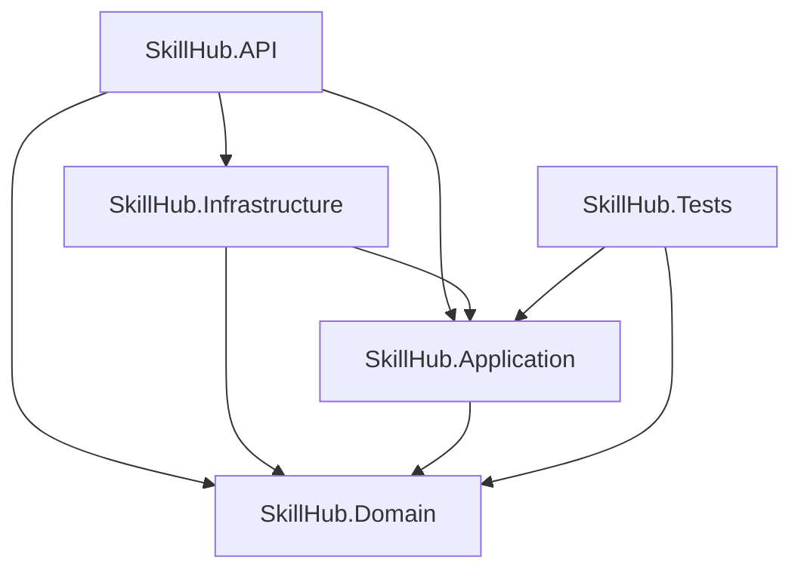

# SkillHub - Workshop Reservation & Management Platform

SkillHub is an enterprise-grade backend solution and web application built with **.NET 10** and **C#**, adhering strictly to **Clean Architecture** and **Domain-Driven Design (DDD)** principles. It manages workshop enrollments, capacity constraints, schedule conflict detection, automated PDF certificate vouchers, and bulk Excel data importation.

---

## 🏛️ Architecture Overview

The solution is partitioned into modular, loosely coupled projects:

```
SkillHub/
├── SkillHub.Domain/            # Entities, Domain Enums, Business Rules & Domain Exceptions
├── SkillHub.Application/       # Use Cases, DTOs, Business Services, Interfaces, ClosedXML, QuestPDF
├── SkillHub.Infrastructure/    # EF Core, Identity, Sqlite Database, Repositories, JWT Token Generator, Seeder
├── SkillHub.API/               # REST API Controllers, Middlewares, Swagger UI, Single Page Web Client (wwwroot)
└── SkillHub.Tests/             # Unit tests with xUnit and Moq covering all 6+ business rules
```

### Dependency Flow


---

## 📋 Business Rules Matrix

All business constraints reside entirely in Domain Entities and Application Services, completely isolated from API controllers:

| Rule | Enforcement Location | Description |
| :--- | :--- | :--- |
| **Maximum Capacity** | `Workshop.HasAvailableCapacity()` & `EnrollmentService` | Prohibits enrollments once `Workshop.Enrollments.Count(Status == Active) >= Workshop.MaxCapacity`. |
| **No Duplicates** | `EnrollmentService` | Prevents multiple active enrollments for the same `(ParticipantId, WorkshopId)`. |
| **Schedule Conflict** | `Workshop.OverlapsWith(...)` & `EnrollmentService` | Validates that a participant has no overlapping active workshop where `(NewStart < ExistingEnd) && (NewEnd > ExistingStart)`. |
| **Future Only** | `Workshop.ValidateDates(...)` & `EnrollmentService` | Workshops must be created and enrolled in the future (`StartDateTime > DateTime.UtcNow` and `EndDateTime > StartDateTime`). |
| **Participant Cancellation** | `Enrollment.CancelByParticipant(...)` | Participants can cancel only with at least 24 hours prior notice (`Workshop.StartDateTime - UtcNow >= 24h`). |
| **Employee Cancellation** | `Enrollment.CancelByEmployee(...)` | Employees can cancel without the 24-hour limit, as long as the workshop has not started yet. |
| **Re-enrollment** | `Enrollment.Reactivate(...)` | A previously cancelled enrollment is reactivated instead of creating duplicate records if spots are available and there are no conflicts. |
| **Bulk Excel Import** | `ExcelImportService` | Parses `.xlsx` file row-by-row using **ClosedXML**, catching row-level exceptions and committing valid records individually. |
| **PDF Generation** | `QuestPdfService` | Generates official PDF enrollment certificates via **QuestPDF** exclusively for `Active` enrollments. |

---

## 🔑 Default Credentials & Seeding (`SkillHub_Data.xlsx`)

The application automatically seeds baseline database records from `SkillHub_Data.xlsx` upon startup:
- **`Instructors` sheet**: Seeded as system users with role `Employee`.
- **`Participants` sheet**: Seeded as system users with role `Participant`.
- **`Workshops` sheet**: Seeded as published workshops linked to their respective instructors.
- **`Enrollments` sheet**: **Not loaded at startup**. It is reserved exclusively for the bulk import endpoint `POST /api/v1/enrollments/import` (or via the Employee web dashboard).

### Instructors / Employees (Role: `Employee`)
| Full Name | Email | Password | Specialty |
| :--- | :--- | :--- | :--- |
| Andrés Felipe Mejía Arango | `andres.mejia@correo.com` | `Instructor2026*` | Fotografía |
| Rosa Elena Barrios Polo | `rosa.barrios@correo.com` | `Instructor2026*` | Cocina |
| Mauricio Jiménez Cárdenas | `mauricio.jimenez@correo.com` | `Instructor2026*` | Oratoria |
| Natalia Herrera Castaño | `natalia.herrera@correo.com` | `Instructor2026*` | Diseño gráfico |
| Hernán Darío Quintero Gil | `hernan.quintero@correo.com` | `Instructor2026*` | Música |
| Paola Andrea Vargas Mora | `paola.vargas@correo.com` | `Instructor2026*` | Marketing digital |

### Sample Participants (Role: `Participant`)
| Full Name | Email | Password |
| :--- | :--- | :--- |
| Jorge Andrés Pérez Rojas | `jorge.perez@correo.com` | `Skillhub2026*` |
| Luz Marina Ospina Ríos | `luz.ospina@correo.com` | `Skillhub2026*` |
| Carlos Eduardo Rincón Díaz | `carlos.rincon@correo.com` | `Skillhub2026*` |
| Valentina Gómez Ruiz | `valentina.gomez@correo.com` | `Skillhub2026*` |

---

## 🚀 Endpoints Specification (`SkillHub.API`)

| Method | Route | Access | Description |
| :--- | :--- | :--- | :--- |
| `POST` | `/api/v1/auth/register` | Public | Register new user with default role `Participant`. |
| `POST` | `/api/v1/auth/login` | Public | Authenticate user, issuing JWT with `sub`, `email`, and `role` claims. |
| `GET` | `/api/v1/workshops` | Public | List future workshops with `availableSpots = maxCapacity - activeEnrollments`. |
| `GET` | `/api/v1/workshops/{id}` | Public | Detailed workshop view including spots and instructor information. |
| `POST` | `/api/v1/workshops` | Employee | Create a new workshop. |
| `GET` | `/api/v1/workshops/{id}/enrollments` | Employee | Retrieve all enrollments associated with a workshop. |
| `POST` | `/api/v1/enrollments` | Participant | Enroll the authenticated participant into a workshop. |
| `GET` | `/api/v1/enrollments/mine` | Participant | List all personal enrollments (active and cancelled). |
| `PATCH` | `/api/v1/enrollments/{id}/cancel` | Owner / Employee | Cancel an enrollment applying the corresponding domain policy. |
| `POST` | `/api/v1/enrollments/import` | Employee | Upload `.xlsx` file for bulk workshop import. |
| `GET` | `/api/v1/enrollments/{id}/certificate` | Owner / Employee | Download official enrollment PDF voucher (`application/pdf`). |
| `GET` | `/api/v1/reports/top-workshops` | Employee | Ranking of workshops sorted descending by active enrollments. |

---

## 🗄️ Database & SQL Script

- Database provider: **SQLite** (`skillhub.db`), fully configured with EF Core Code-First and Identity.
- The complete SQL migration script is located at:
  - [`SkillHub_Schema.sql`](./SkillHub_Schema.sql)

---

## 🛠️ Getting Started & Running

### Prerequisites
- [.NET 10 SDK](https://dotnet.microsoft.com/)

### 1. Run Unit Tests
```bash
dotnet test
```

### 2. Run the Web API & User Interface
```bash
dotnet run --project SkillHub.API
```

- **Interactive Web Interface**: Open your browser at `http://localhost:5000` (or the configured launch URL).
- **Swagger Documentation**: Open `http://localhost:5000/swagger`.

---

## 👥 Authors & Maintainers

- **SkillHub Development Team**
  - Cohorte 5 - Advanced Software Development & Architecture
  - Universidad / Bootcamp SkillHub Initiative 2026
